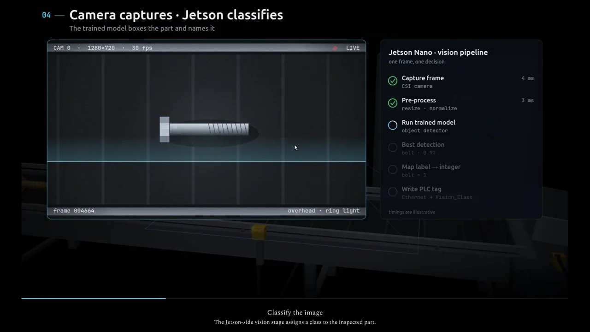

# ConVision data flow

An animated walkthrough of the proposed ConVision vision-guided conveyor sorter for ICET 4751. It follows an image classification result from the camera and Jetson Nano to the PLC and sorting mechanism.

[](https://trylen22.github.io/demos/convision/)

[Watch the captioned demonstration](https://trylen22.github.io/demos/convision/). The page also provides the MP4 and subtitle file.

[Open the full interactive walkthrough](https://trylen22.github.io/convision-dataflow/). Select a chapter, scrub the timeline, or use fullscreen. On a phone, landscape orientation provides more room for the diagrams.

## Run locally

```bash
git clone https://github.com/Trylen22/convision-dataflow.git
cd convision-dataflow
python3 -m http.server 8000 --bind 127.0.0.1
```

Open `http://127.0.0.1:8000/`. The published page is static and requires no package installation.

## Source and scope

`index.html` is generated by `build-mobile.py` from the capstone source `convision-dataflow.html`. That source is maintained outside this publication repository; the generated page can run independently, but rebuilding requires the source file expected by the script.

The walkthrough explains system responsibilities and data flow. Hardware, communication protocol, and timing are illustrative. This repository does not contain a deployed conveyor controller or a validated end-to-end sorting system.
